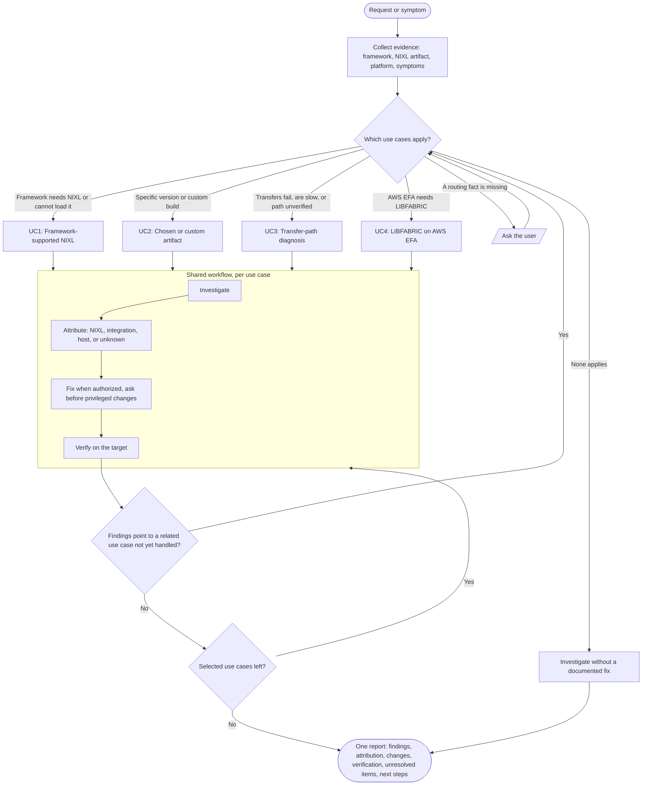

# NIXL Install

## Purpose

Help an AI agent investigate and address NIXL installation, integration,
configuration, and runtime issues. For documented use cases, apply
evidence-backed guidance. For other issues, investigate and provide findings
and next steps.

## Prerequisites

Access to the target environment or relevant user-provided evidence.

## Instructions

### Routing

Route immediately when the applicable use case is clear. Otherwise, investigate
available evidence. Ask the user only when a required routing fact or choice
cannot be determined another way.

### Supported use cases

1. **[Framework-supported NIXL](references/integration-install.md)** — Use when
   a framework deployment needs NIXL installed, or cannot load or use its
   supported NIXL package.
2. **[Chosen or custom NIXL artifact](references/custom-artifact.md)** — Use
   when the deployment needs a specific NIXL version or custom build instead of
   the framework-supported package.
3. **[Transfer-path diagnosis](references/transfer-path.md)** — Use when
   transfers fail, perform unexpectedly slowly, or require verification of the
   backend, transport, or link being used.
4. **[LIBFABRIC on AWS EFA](references/libfabric-efa.md)** — Use when an AWS EFA
   deployment needs LIBFABRIC installed, selected as the NIXL backend,
   configured, or verified.

When multiple use cases apply, use all relevant guidance in the order of
relevance and technical dependencies.

When none applies, investigate and provide findings and next steps without
implying that a documented fix exists.

### Workflow

### Related use cases

After each use case, check whether its findings select another one:

- **UC1 to UC2:** the framework-supported package cannot meet the requirement, such as a needed version or backend.
- **UC1 or UC2 to UC3:** NIXL loads, but transfers fail, are slow, or use an unexpected backend.
- **UC3 to UC4:** the deployment runs on AWS EFA and should use LIBFABRIC.
- **UC3 to UC1 or UC2:** the required backend is missing from the installed artifact.
- **UC4 to UC2:** the NIXL artifact lacks LIBFABRIC.

Handle installation (UC1 or UC2) before transfer paths (UC3 or UC4) when both apply.

### Shared workflow

Process every selected use case in the chosen order. Findings from one use case
may inform the others.

1. **Investigate.** Follow the use-case guidance and inspect relevant target
   artifacts, configuration, logs, runtime evidence, source, and
   version-matched documentation. Proceed autonomously with read-only checks.
   Continue meaningful independent checks when another check fails, and stop
   only when further investigation would not change the attribution or remedy.
2. **Attribute.** Attribute findings to NIXL, the integrating software, the host
   environment, or unknown. Distinguish observed evidence from inference and
   unconfirmed hypotheses.
3. **Fix when authorized.** Follow the user's requested mode and authorization.
   Reversible userspace and integration changes within scope may proceed
   without further interruption. Ask before privileged, stack-changing, or
   difficult-to-reverse changes.
4. **Verify.** Run proportionate checks against the exact target when possible.
   Report only what was executed and observed. If verification is blocked or
   fails, mark that outcome unresolved and continue with the remaining use
   cases when possible.

After all selected use cases, provide one concise report covering findings,
attribution, changes, verification, unresolved outcomes, and next steps. Report
success only for a completed investigation or a requested fix that was
verified.
